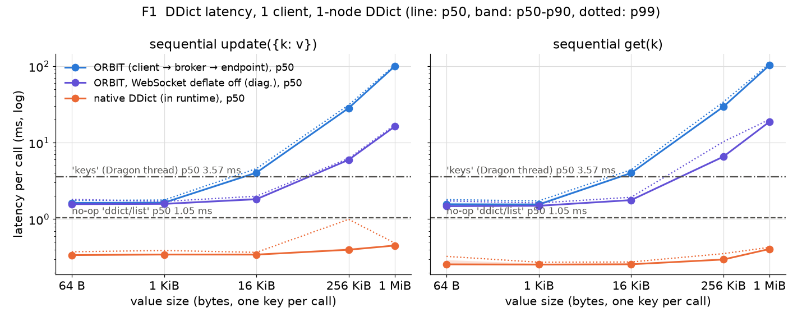
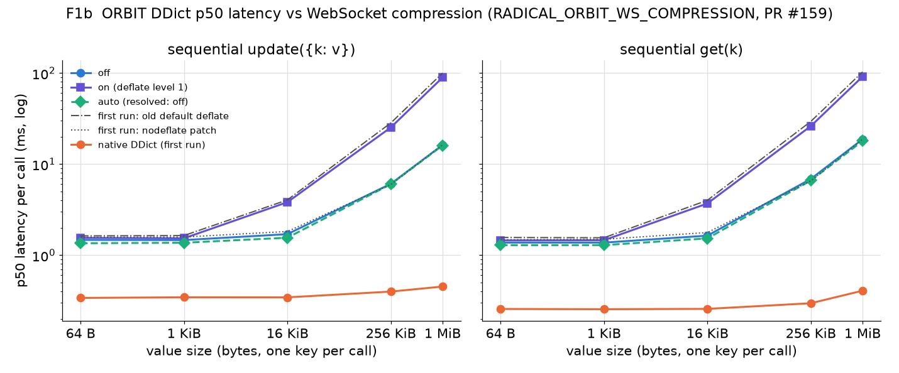
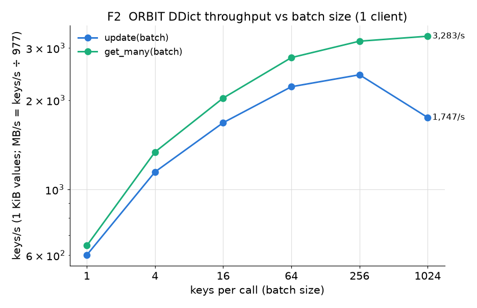
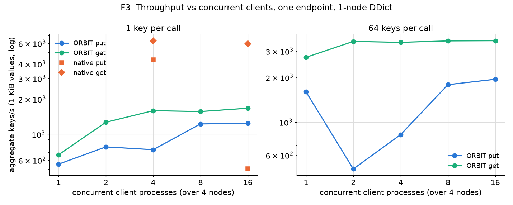
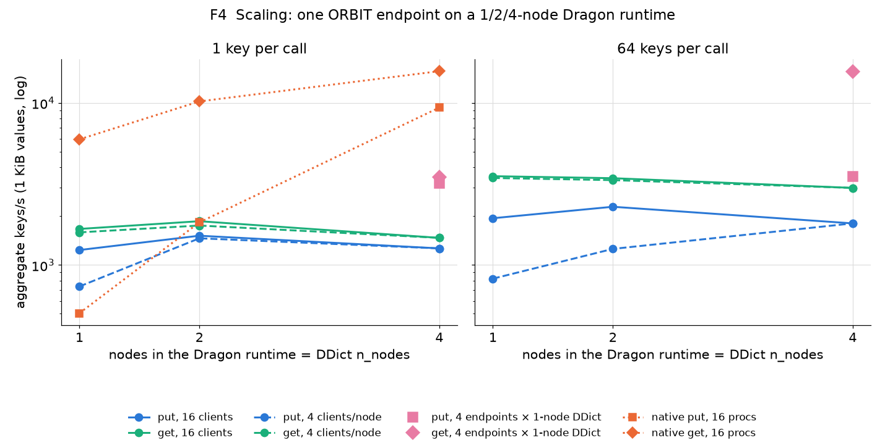
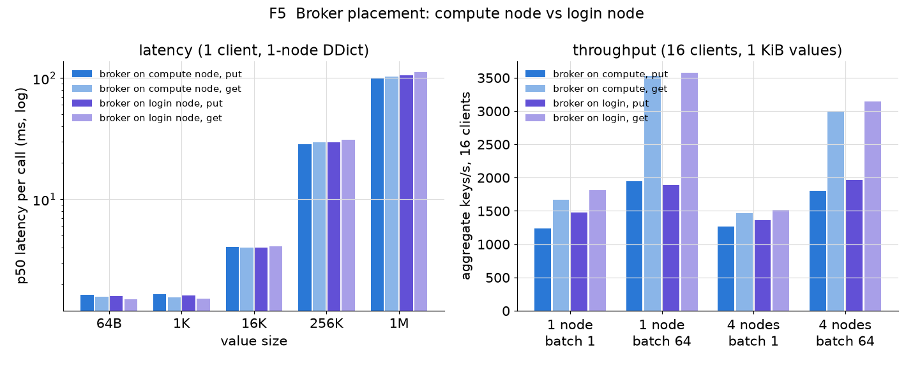
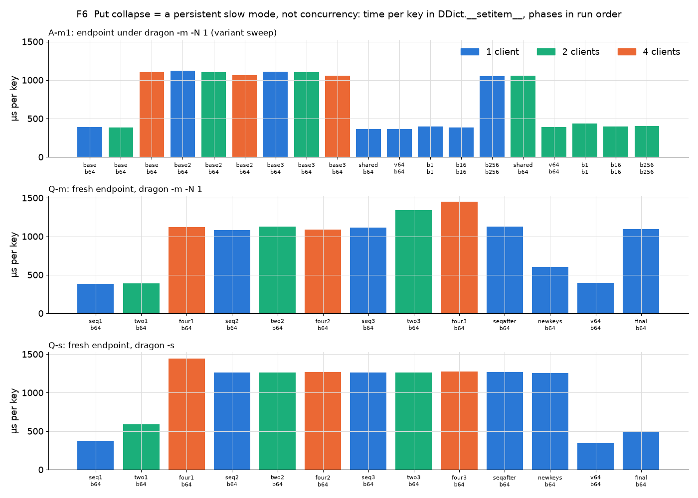
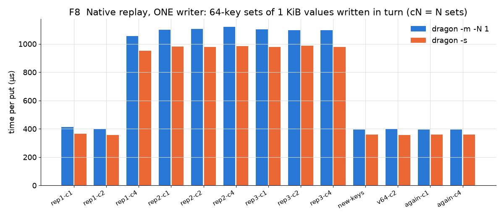

# Dragon DDict through ORBIT: first latency, throughput and scaling runs

The first performance and scaling numbers for the `dragon` plugin (PR #156) on
Perlmutter CPU nodes, measured 2026-11-04. A client reaches a Dragon DDict
through the ORBIT broker and an endpoint running inside a Dragon runtime. The
numbers are compared with native DDict access from inside the runtime.

Everything here comes from a single run per point. Treat the numbers as
first estimates, not a characterization (see [Caveats](#caveats)).

## Setup

```
client (plain python, EndpointRuntime)        broker (compute node 0, or login node)
   │  WSS, msgpack envelope, JSON body              │
   └──────────────► broker ◄────────────────────────┘
                      │ WSS
                      ▼
          endpoint (radical-orbit-endpoint.py, -p dragon)
          launched by `dragon`, runs in the Dragon runtime
                      │ one dedicated Dragon thread
                      ▼
          DDict (managers_per_node=1, n_nodes=K, 8 GiB total)
```

| | |
|---|---|
| Machine | Perlmutter CPU nodes: 2× AMD EPYC 7763 (128 cores, 256 HW threads), 512 GB, Slingshot `hsn0` |
| Allocation | `salloc -N 4 -C cpu -q interactive -A amsc007`, job 60792061, nodes `nid[200032-200035]` |
| ORBIT | PR #156 head `7da4db9` (devel merged), from the source tree (`PYTHONPATH=src`) |
| Dragon | `dragonhpc` 0.15.0, TCP transport |
| Python | cray-python 3.12.12, websockets 17.3, uvicorn 0.54.0, fastapi 0.162.0, msgpack 1.2.4 |
| Slurm | 25.11.8 |

- **Broker:** `bin/radical-orbit-broker.py -p ''` (no hosted plugins; the
  gateway stays on), TLS with the demo pair, a token generated for the run.
  It runs on node 0 (primary) or on the login node `login20` (F5).
- **Endpoint:** `dragon -m -N K bin/radical-orbit-endpoint.py -p dragon`
  started from a one-node step on node 0. The plugin uses the runtime it runs
  in (`dragon.in_dragon()`). Variant B uses `dragon -s` instead, with one
  endpoint per node.
- **DDict:** created through ORBIT, `managers_per_node=1`, `n_nodes=K`,
  `total_mem=8G`.
- **Clients:** `bench_client.py`, one process per client, each with its own
  `EndpointRuntime` (and so its own WebSocket). Clients are started with
  `srun` and spread evenly over the allocation's 4 nodes (block
  distribution). Runs with fewer than 4 clients use nodes 1..3, off the broker
  node. The latency and batch clients run on node 1.
- **Values:** random `bytes`, which travel base64-encoded in the JSON body
  (about 4/3 of the raw size). Throughput runs use 1 KiB values.
- **No-op baselines:** `ddict/list` is a full ORBIT round trip
  (client → broker → endpoint plugin → back) that makes no Dragon call.
  `keys` on the DDict (about 5 keys) adds the hop to the Dragon thread and
  one Dragon call.
- **Native baseline:** `native_bench.py` under `dragon -s` (latency) or
  `dragon -m -N K` (16 Dragon processes, round-robin over the runtime's
  nodes, each looping on its own 64 keys).

## Results

### F1: latency vs value size



| value | ORBIT put p50 / p99 (ms) | ORBIT get p50 / p99 (ms) | native put p50 (ms) | native get p50 (ms) | ORBIT without deflate, put / get p50 (ms) |
|---|---|---|---|---|---|
| 64 B    | 1.63 / 1.75   | 1.56 / 1.80   | 0.34 | 0.26 | 1.57 / 1.47 |
| 1 KiB   | 1.64 / 1.77   | 1.55 / 1.73   | 0.34 | 0.25 | 1.58 / 1.49 |
| 16 KiB  | 4.04 / 4.57   | 4.00 / 4.41   | 0.34 | 0.26 | 1.82 / 1.77 |
| 256 KiB | 28.3 / 31.0   | 29.4 / 33.9   | 0.40 | 0.30 | 5.95 / 6.54 |
| 1 MiB   | 99.8 / 102.9  | 102.7 / 107.3 | 0.45 | 0.41 | 16.3 / 18.7 |

The no-op round trips (p50): `ddict/list` takes 1.05 ms, and `keys` takes
3.57 ms. The figures use 200 samples per point.

### F1b: latency vs WebSocket compression (PR #159, 2026-11-05)



This rerun of F1 uses the compression switch from PR #159
(`feature/ws-compression-switch` at `0150898`), trial-merged locally onto
this branch; the merge is not pushed. Each configuration sets
`RADICAL_ORBIT_WS_COMPRESSION` for both the endpoint and the client. The
broker accepts deflate by default.

| | |
|---|---|
| Allocation | 3 CPU nodes (job 60867609): broker on node 0, latency client on node 1, endpoint on node 2 under `dragon -s` |
| Hops | client → broker → endpoint, each on its own node, as in F1 |
| Endpoint | a fresh endpoint and DDict per configuration |
| Samples | 200 per size, as in F1 |
| Script | `wscomp_bench.sh` |

p50 per call, put / get (ms):

| value | off | on (deflate level 1) | auto |
|---|---|---|---|
| 64 B    | 1.47 / 1.37   | 1.55 / 1.45   | 1.35 / 1.28   |
| 1 KiB   | 1.46 / 1.37   | 1.53 / 1.46   | 1.37 / 1.29   |
| 16 KiB  | 1.70 / 1.64   | 3.81 / 3.69   | 1.55 / 1.53   |
| 256 KiB | 6.07 / 6.86   | 25.2 / 26.1   | 6.01 / 6.59   |
| 1 MiB   | 16.2 / 18.7   | 89.2 / 91.2   | 16.0 / 17.9   |

- **`auto` resolved to off on both hops.** The client measured a 1.0 ms
  TCP connect time and the endpoint 1.1 ms, against the 10 ms threshold
  (`data/wscomp/decision-log.txt`):
  `[Runtime] ws_compression=auto: connect 1.1 ms (threshold 10.0 ms) -> deflate off`.
  Its numbers match `off`.
- **`off` matches the first run's nodeflate diagnostic** (1 MiB 16.3 /
  18.7 ms). Large values are 5–6× faster than with deflate, and values up
  to 1 KiB are unchanged.
- **`on` (level 1) is only slightly faster than the old hard-wired
  default** (1 MiB 89 vs 100 ms). On an in-allocation hop, deflate stays
  expensive for base64 payloads at any level.
- **The old `nodeflate/sitecustomize.py` patch has no effect on #159.**
  With deflate on, #159 offers it through `extensions=[...]`, and the patch
  only forces `compression=None`. A run with `on` plus the patch was
  therefore identical to `on` (`data/lat-wscomp-nodeflate.json`, not
  plotted). The first-run curves in F1b stand in as the cross-check.
- All four endpoint stops (SIGTERM to the endpoint only) finished in 0–1 s.
  The run took 4:47 on 3 nodes, about 0.24 node-hours.

### F2: throughput vs batch size (1 client, 1 KiB values)



| keys per call | 1 | 4 | 16 | 64 | 256 | 1024 |
|---|---|---|---|---|---|---|
| `update` keys/s  | 601 | 1,144 | 1,677 | 2,217 | 2,433 | 1,746 |
| `get_many` keys/s | 646 | 1,336 | 2,031 | 2,780 | 3,158 | 3,282 |
| `get_many` MB/s  | 0.66 | 1.37 | 2.08 | 2.85 | 3.23 | 3.36 |

### F3: throughput vs concurrent clients (one endpoint, 1-node DDict)



Aggregate keys/s, put / get:

| clients | 1 | 2 | 4 | 8 | 16 |
|---|---|---|---|---|---|
| 1 key per call   | 553 / 666   | 778 / 1,264 | 736 / 1,588 | 1,223 / 1,561 | 1,235 / 1,667 |
| 64 keys per call | 1,599 / 2,725 | 483 / 3,487 | 822 / 3,438 | 1,784 / 3,516 | 1,941 / 3,526 |

Native reference, 1-node DDict: 4 processes reach 4,321 / 6,302 and
16 processes reach 503 / 5,951.

### F4: scaling vs nodes (main question)



Aggregate keys/s, put / get, 1 KiB values:

| setup | 1 node | 2 nodes | 4 nodes |
|---|---|---|---|
| one endpoint, 16 clients, 1 key/call    | 1,235 / 1,667 | 1,514 / 1,860 | 1,264 / 1,468 |
| one endpoint, 16 clients, 64 keys/call  | 1,941 / 3,526 | 2,284 / 3,427 | 1,803 / 2,986 |
| one endpoint, 4 clients/node, 1 key/call   | 736 / 1,588 | 1,459 / 1,749 | 1,264 / 1,468 |
| one endpoint, 4 clients/node, 64 keys/call | 822 / 3,438 | 1,255 / 3,334 | 1,803 / 2,986 |
| **variant B**: 4 endpoints × 1-node DDict, 16 clients, 1 key/call |  |  | 3,186 / 3,491 |
| **variant B**: 4 endpoints × 1-node DDict, 16 clients, 64 keys/call |  |  | 3,498 / **15,599** |
| native, 16 processes, 1 key/op | 503 / 5,951 | 1,830 / 10,200 | 9,342 / 15,677 |

### F5: broker placement (compute node vs login node)



| | broker on compute node 0 | broker on login20 |
|---|---|---|
| latency p50, 1 KiB put / get (ms) | 1.64 / 1.55 | 1.61 / 1.52 |
| latency p50, 1 MiB put / get (ms) | 99.8 / 102.7 | 105.6 / 111.2 |
| 1 node, 16 clients, 64 keys/call (keys/s, put / get) | 1,941 / 3,526 | 1,883 / 3,571 |
| 4 nodes, 16 clients, 64 keys/call (keys/s, put / get) | 1,803 / 2,986 | 1,966 / 3,141 |

### Outbound connectivity from compute nodes

`srun ... curl -sS -m 5 -o /dev/null -w '%{http_code}' https://github.com`
returned `200` from `nid200032`, and so did `https://pypi.org`. Compute nodes
can open outbound HTTPS to the internet, so an external broker (e.g.
radical.three) is reachable directly with `--tunnel none`, at least on 443.
Other ports were not tested.

## Findings

1. **Per-call floor of about 1.0–1.6 ms.** The ORBIT round trip through the
   broker costs about 1 ms (`ddict/list`). A small put or get adds 0.5 ms
   for the Dragon thread hop and the native DDict op (0.25–0.34 ms
   natively). That makes ORBIT about 5× native for small values. `keys` is
   slower (3.6 ms) than a get even on a near-empty DDict.
2. **Large values are dominated by WebSocket permessage-deflate.** ORBIT
   hard-wires `compression='deflate'` on the runtime side
   (`runtime.py`, `websockets.connect(..., compression='deflate')`) and the
   broker accepts it (`broker.py`, `ws_per_message_deflate=True`). Every
   request and reply is deflated and inflated on both legs. Base64 of random
   bytes compresses poorly, so this is pure CPU. 1 MiB took about 100 ms
   (about 10 MB/s). With deflate turned off on the connecting side (stage
   `k1nd`, `nodeflate/sitecustomize.py`, a diagnostic monkeypatch, not an
   ORBIT change), 1 MiB took 16–19 ms (5.9×) and 256 KiB took 6 ms
   instead of 28 ms. Small-value latency and throughput did not change.
   Recommendation: make compression configurable, or default it off for
   this traffic. PR #159 (merged) does that; see F1b. On devel since #159, use
   `RADICAL_ORBIT_WS_COMPRESSION=off` instead of the patch, which no longer
   has any effect. Base64 inside JSON inside msgpack adds a further 4/3 on
   bytes values.
3. **Throughput ceiling: the single Dragon thread.** Batching helps up to
   about 256 keys per call. Beyond that, `get_many` levels off at about
   3.3–3.5k keys/s and `update` at about 2.2–2.5k keys/s, which is about
   1/(native per-key latency). All Dragon calls of an endpoint are
   serialized on one thread, by design (dragonhpc 0.15.0 hangs on concurrent
   DDict calls from several threads), and the backend issues one DDict
   operation per key. More clients do not raise that ceiling: one endpoint
   saturates at about 3.5k gets/s with 2 or more clients.
4. **Scaling with nodes is flat for one endpoint.** Spreading the DDict over
   2 or 4 nodes does not raise ORBIT throughput (2,986–3,526 gets/s at
   1/2/4 nodes, 64 keys/call): the serial Dragon thread, not the DDict, is
   the bottleneck. Natively, the same DDict scales (16 processes: 5.9k →
   10.2k → 15.7k gets/s). **Variant B (one endpoint per node) scales.** Four
   endpoints with their own 1-node DDicts reach 15.6k gets/s (4.4× one
   endpoint, matching native at 4 nodes) and 3.5k puts/s. Per-node endpoints,
   or several Dragon threads or processes per endpoint, are the way to scale.
   Batched Dragon calls in the backend (if Dragon offers them) would lower
   the per-key cost.
5. **Put throughput collapses with concurrent writers (open).** At 64 keys
   per call, one client puts 1.6k keys/s (40 ms per call). Two clients
   together get only 483 keys/s (268 ms per call), and throughput recovers to
   about 1.9k at 16 clients. Gets do not show this. The native run shows a
   similar collapse on a single manager (4 writer processes: 4.3k puts/s,
   16 processes: 503 puts/s). Through ORBIT, however, all puts come from the
   one Dragon thread, so this is not explained yet. **Resolved:** a
   history-dependent slow mode in Dragon's DDict put path, not concurrency.
   See [Put collapse](#put-collapse-investigation-2026-11-04).
6. **Broker placement does not matter inside NERSC.** A broker on the login
   node gives the same latency and throughput as one on a compute node,
   within about 5%. The 1 MiB latency is about 6–8% higher, which may come
   from deflate CPU on the shared login node.
7. **Endpoint teardown is not clean** (no plugin change made). With a
   DDict still present, SIGTERM to the endpoint ran into
   `dragon.on_host_stop exceeded 15s` and
   `Dragon thread busy after 20s at exit: runtime and DDicts may be left
   behind` (seen on the login node with `dragon -s`). The DDict manager
   processes and their `/dev/shm` pools stayed behind and had to be removed by
   hand. In the allocation the benchmark destroys the DDict through ORBIT
   first (that always succeeded), but the endpoint still did not exit within
   25 s after SIGTERM, under either launcher. With `dragon -m` the log shows
   "Detected an abnormal exit", then a paramiko ssh cleanup attempt failing
   on an encrypted key. With `dragon -s` the step had to be terminated. The script then kills the step and runs
   `dragon-cleanup` on every node. After the step kill, 2–6 Dragon processes
   were left on one node per teardown. **Resolved:** our stop method also
   signalled the `dragon` launcher. An endpoint-only SIGTERM shuts down
   cleanly within seconds. See [Teardown](#teardown-investigation-2026-11-04).
8. **Launch pitfall: `dragon -m` from inside an srun step.** Inside a step,
   Slurm sets `SLURM_JOB_NODELIST` to the step's node and leaves out
   `SLURM_JOB_NUM_NODES`, so the launcher fails ("SLURM_JOB_NUM_NODES
   environment variable is not set", then "Unable to acquire backend network
   configuration"). Its inner `srun` is also confined to one node.
   `step_env.sh` restores the job-level variables and drops the step
   variables, which matters for an endpoint started as a step of a
   `--no-shell` allocation. A batch-script launch is not affected.
9. **Nothing broke under load.** There were no hangs, errors or 413s at
   up to 16 concurrent clients, 1024-key batches (about 1.4 MB request bodies)
   and 1 MiB values. Endpoint start under `dragon -m -N 4` took about 15 s,
   and a DDict create took about 2 s.

## Put collapse (investigation, 2026-11-04)

Follow-up to finding 5. Allocation 60801663, 4 CPU nodes
`nid[200056-200059]`, the same software as above. The scripts are
`inv_bench.sh`, `inv2_bench.sh` and `native_bench.py` (modes `replay` and
`trend`), and the analysis is `inv_analyze.py`. The endpoint ran with
`diag/sitecustomize.py`, a diagnostic import hook (no ORBIT change). It logs
every Dragon-thread call with its queue wait, exec time and the time spent
inside `DDict.__setitem__`/`__getitem__`, plus the route-handler time.

**Answer: neither concurrency nor ORBIT causes it. It is a history-dependent
slow mode inside the Dragon DDict put path.** The manager spends the extra
time in Dragon's heap allocator. The concurrency in the first run only
coincided with the key pattern that triggers the slow mode.





Evidence:

1. **The time is inside `DDict.__setitem__`, not in ORBIT.** Per key, put
   takes 380–390 µs in fast mode and 1,060–1,130 µs in slow mode, while get
   stays at 270–300 µs in both. The route handler time equals the Dragon
   thread's queue wait plus exec time, so the transport adds nothing. The
   queue wait only reflects the serial Dragon thread: c clients wait about
   (c−1) × exec. (`data/inv-summary.json`, columns
   `put_dragon.key_us / q_ms / x_ms`.)
2. **It is not concurrency.** Once it starts, a single client is as slow as
   four (A-m1, 3 reps; per key in µs):

   | rep | c = 1 | c = 2 | c = 4 |
   |---|---|---|---|
   | 1 | 392 | 383 | **1,105** |
   | 2 | **1,124** | 1,104 | 1,061 |
   | 3 | **1,111** | 1,103 | 1,060 |

   Fresh endpoints repeat the same pattern (F6). Q-m (`-m -N 1`) goes
   380 → 387 → **1,120** µs/key at the first 4-set phase, and Q-s (`-s`)
   goes 367 → 591 → **1,446**. Every later phase stays at about 1,060–1,450
   µs/key, whatever the client count. Leaving the slow mode is less
   predictable:
   - writing 64 B values cleared it in every sequence (A-m1, Q-m, Q-s:
     346–394 µs/key);
   - writing new key names cleared it in A-m1 and partly in Q-m (604), but
     not in Q-s (1,258);
   - in Q-m, 1 KiB writes to the old keys went slow again afterwards
     (`final`: 1,093).

   Keys per call (1, 16, 64, 256) matter only through which key sets they
   touch: `b256` (256 keys) entered the slow mode in A-m1, too.
3. **It is not ORBIT, and not the launcher.** One native writer (no ORBIT,
   no threads, no concurrency) that writes the same 64-key sets in the same
   order (`native_bench.py replay`) reproduces it exactly (µs per put):

   | launcher | rep1 c=1 | rep1 c=2 | rep1 c=4 | rep2/3, any c | 64 new keys | then anything, incl. c=4 |
   |---|---|---|---|---|---|---|
   | `dragon -m -N 1` | 414 | 398 | **1,055** | 1,096–1,121 | 394 | 393–398 |
   | `dragon -s` | 364 | 355 | **950** | 977–986 | 359 | 357–358 |

   Here, writing new keys cleared the slow mode, and it stayed fast even for
   the 4-set pattern afterwards. Overwriting a single 64-key set for 40 s
   (`trend`, about 100k puts) never slows down (2.4–2.9k puts/s throughout),
   nor does a 2× value size.
4. **Where the manager spends the time** (py-spy with native frames, DDict
   manager process, 3 s samples during put phases): in the slow phase,
   169/298 samples are at `manager.py:3468` (`recvh.close()` at the end of
   `put`). That call goes `dragon_fli_close_recv_handle` →
   `_send_stream_channel` → `dragon_memory_alloc_blocking` →
   `dragon_heap_malloc_blocking` → `_dragon_heap_malloc` →
   `dragon_bitset_reset` → **`dragon_bitset_zeroes_to_right`**, a bitset scan
   in Dragon's heap allocator. In a fast phase the manager mostly waits in its
   receive loop and the allocation barely appears. On the endpoint side the
   Dragon thread spends 90% of `__setitem__` waiting for the manager's reply
   (`_recv_resp`) in slow mode, against 64% in the faster phase.
   Raw samples: `data/inv-pyspy/`. The other busy Dragon process is a
   ProcessGroup exception-queue monitor busy-polling `dragon_fli_poll`; it
   looks the same in both phases.
5. **More managers or nodes:** `managers_per_node=2` and `n_nodes=2` stay fast
   at 1–2 clients (369–382 and 450–459 µs/key). Their short sequences never
   ran the 4-set pattern that triggers the slow mode, so they are not
   evidence that more managers prevent it.
6. **A separate, native-only effect:** many concurrent writers on one
   manager. One fresh DDict per run, 1 KiB values, puts/s:

   | writers | `-m`, 1 manager | `-s`, 1 manager | `-m`, 2 managers |
   |---|---|---|---|
   | 1 | 2,533 | 2,818 | |
   | 2 | 4,245 | 4,652 | 4,636 |
   | 4 | 4,135 | | |
   | 16 | **1,501** | **1,785** | 4,340 (gets 11,278) |

   At 2 writers, shared keys give 4,031 and 64 B values 3,198 puts/s. The
   16-writer drop points at contention when writers outnumber the manager's streams
   (`streams_per_manager=5` by default), but I have not verified that inside
   Dragon. ORBIT never shows this effect: the endpoint is a single writer.

**Fix and where it belongs:** in Dragon (not ORBIT, not the plugin). Report it to HPE with the native
reproducer:
`dragon -s native_bench.py replay --duration 4`. It needs one node and runs
in under a minute, and the slow mode starts at the `rep1-c4` phase. The
blocking allocation in the FLI stream-channel return path (`recvh.close()`)
degrades with the allocator's history. Nothing to fix in `plugin_dragon`
(no plugin change was made). Possible workarounds, untested: more managers
per node, or a larger DDict pool (`total_mem`).

## Teardown (investigation, 2026-11-04)

Follow-up to finding 7. `teardown_probe.sh` records the surviving process
list once per loop tick (about 1 s, longer while a dump runs) for up to 60
ticks, plus py-spy dumps (native frames) of the
endpoint at +2/+8/+16/+24/+40 s. Leftovers (`/dev/shm` files and Dragon
processes per node) are recorded before each `dragon-cleanup`. The
"dragon_procs=2" baseline on every node is the pgrep's own shell.

**Answer: the shutdown is clean when SIGTERM reaches only the endpoint
process. It breaks when the signal reaches the `dragon` launcher.** The
first benchmark's "endpoint does not exit in 25 s" was caused by how it
stopped endpoints: `pkill -f radical-orbit-endpoint.py` also matches the
launcher, whose command line names the endpoint script.

| case (live DDict) | where | endpoint exits | leftovers |
|---|---|---|---|
| SIGTERM to the endpoint only, `dragon -s` | login, compute | a few seconds; DDict destroyed; launcher reports "head proc exited, code 0" | none |
| SIGTERM to the endpoint only, `dragon -m -N 1` | compute | a few seconds | none |
| endpoint-only stops of all A-stage endpoints (`-s`, `-m -N 1/2`) | compute | 0–2 s | none |
| SIGTERM to launcher and endpoint, `-s` | login | **35 s** (15 s `on_host_stop` bound + 20 s `close_sync` join) | 3 DDict processes, 4 `/dev/shm` pools |
| same, after destroying the DDict through ORBIT | login | about 1 s | the launcher's 3 pools |
| SIGINT to the launcher only, `-s` | login | not at all (both stay up > 60 s); a later endpoint SIGTERM is clean | none |
| SIGTERM to the srun step (scancel-like), `-s` | compute | killed: srun SIGKILLs the step within 2 s | 4 pools |
| SIGTERM to the srun step, `-m -N 1` | compute | **never**: still serving after 60 s | 7 pools, 3 processes |

One more endpoint-only stop (Q-m's `ep-aqm`) took 40 s. My blocking py-spy
sampler was attached to the endpoint at that moment, and under ptrace a
signal goes to the tracer first, so I count it as a measurement artefact.
Evidence (events, leftovers, py-spy dumps) is in `data/inv-teardown/`
(`login/` for B1–B5, `compute/` for the four compute cases).

What happens in each failure:

- **`dragon -s` installs no SIGTERM handler** (`launcher/dragon_single.py`
  handles only KeyboardInterrupt), so a SIGTERM kills it outright. The
  runtime services go with it, and the DDict orchestrator and manager
  processes are orphaned. The endpoint's `on_host_stop` then calls
  `DDict.destroy()`, which blocks waiting for a reply that never comes. py-spy
  at +16 s on the Dragon thread shows `destroy (ddict.py:2439)` →
  `_send_receive` → `_recv_resp` → `dragon_fli_recv_bytes`. The endpoint
  log shows `dragon.on_host_stop exceeded 15s`, then the atexit
  `close_sync` join waits another 20 s (`Dragon thread busy after 20s at
  exit`), then the process exits. ORBIT's bounds work, but the endpoint
  needs about 35 s and leaves the DDict processes and pools behind.
  `DDict.destroy()` takes no timeout argument (0.15.0); the DDict's
  `timeout=120` bounds it.
- **The `dragon -m` frontend runs `_dragon_cleanup_bumpy_exit` on SIGTERM**
  ("Detected an abnormal exit", then `dragon-cleanup` over ssh, which fails
  here on an encrypted key). Under srun, a SIGTERM kills the frontend's step,
  while the backend runtime (`dragon-backend`, global services, the endpoint,
  the DDict) runs in a separate step started by the frontend's own srun. That
  step survives orphaned: the endpoint never gets a signal, idles in its main
  loop, and stays registered with the broker until the allocation ends.
- **Not the plugin's DragonThread, not ORBIT's stop ordering:** with an
  intact runtime, `on_host_stop` destroys the DDict, the thread stops and
  the process exits within seconds. The #158 bounds (15 s per plugin) hold.
  The extra 20 s at exit comes from `close_sync` re-joining a thread that
  is already known to be stuck.

**Clean shutdown sequence:** send SIGTERM to the endpoint process only, then
let the endpoint destroy its DDicts, stop the Dragon thread and exit. When
the head process exits, the launcher tears the runtime down normally. This
benchmark now stops endpoints that way (`stop_endpoints`:
`pkill -f '^[^ ]*python3 [^ ]*radical-orbit-endpoint.py'`, which never
matches the launcher).

**Fixes and where they belong:**
- **ORBIT endpoint wrapper / launch (#158 territory):** make sure that
  orchestrated stops reach the endpoint, not the launcher. The wrapper could
  stay the parent of `dragon` (no `exec`), trap TERM/INT and forward SIGTERM
  to the endpoint process. For batch jobs, use `--signal=TERM@<lead>` (or
  `B:USR1@…`) so the endpoint is told before Slurm SIGTERMs every
  process at the walltime. ORBIT's broker `endpoint/disconnect` control
  stops the endpoint from inside and is the cleanest remote stop.
- **Plugin (optional, small):** `close_sync` could skip its 20 s join when the
  async close already timed out. That would cut a broken teardown from about
  35 s to about 15 s. It is a nit, not a correctness bug, so I left it
  unchanged.
- **Dragon:** `dragon -s` should handle SIGTERM like SIGINT (tear down the
  runtime). The `-m` frontend's step kill should take the backend step with
  it. SIGINT to `dragon -s` did not stop a running head process within
  60 s either. Report these to HPE.

## Caveats

- Single run per point and short phases (5 s per concurrent phase, 3 s per
  batch point), so the run-to-run variance is unknown. The put-concurrency
  anomaly (finding 5) needs a repeat.
- The broker, the Dragon frontend and the endpoint share node 0 with up to 4
  clients. The login-node broker shares `login20` with other users.
- `dragon -m -N K` picks the K nodes itself (e.g. `nid200035` for K = 1), so
  the endpoint is not always on node 0.
- At K = 4 the "16 clients" and "4 clients/node" points are the same
  configuration, measured twice; the second run is kept.
- A first `k1nd` attempt was discarded: an earlier copy of `run_bench.sh`
  that was edited while it ran kept going and ran a parallel load against
  the same endpoint. Only the clean rerun is in `data/`.
- Endpoint and broker logging ran at WARNING. ORBIT's own profiler output
  (`endpoint.prof`, about 10 MB per endpoint) is written to the endpoint's
  working directory and kept with the raw logs, not committed.

## Files

| file | what |
|---|---|
| `env.sh` | environment: venv, PATH, PYTHONPATH, cert/key, token (from `$RUNS/token`), log level |
| `run_bench.sh` | launch script (login node, against an existing allocation): stages `probe native broker-compute k1 k1nd k2 k4 varb native1 native2 native4 broker-login stop` |
| `step_env.sh` | lets `dragon -m` run from a one-node step (finding 8) |
| `bench_client.py` | ORBIT client: modes `setup destroy lat batch conc` (`--shared`, `--mpn`) |
| `native_bench.py` | native DDict baseline (a Dragon program): modes `lat conc replay trend` |
| `nodeflate/sitecustomize.py` | diagnostic for `k1nd`: no permessage-deflate on ORBIT's `websockets.connect` (no effect with PR #159, see F1b) |
| `wscomp_bench.sh` | F1b: latency with `RADICAL_ORBIT_WS_COMPRESSION=off/on/auto` (needs the #159 tree on `$TREE`) |
| `analyze.py` | reduces `data/` to `data/summary.json` and plots F1–F5 into `figs/` |
| `inv_bench.sh`, `inv2_bench.sh` | put-collapse and teardown investigation (they source `run_bench.sh` for its functions) |
| `diag/sitecustomize.py` | diagnostic import hook: per Dragon-thread call queue wait, exec time and time in DDict set/get, plus handler time |
| `teardown_probe.sh` | signals (or watches) an endpoint, records survivors and py-spy dumps |
| `inv_analyze.py` | joins client windows with the endpoint diag logs: `data/inv-summary.json`, `data/inv-table.md`, F6 and F8 |
| `data/inv-*`, `data/conc-inv-*` | investigation data: per-rank JSON, native replay/trend/conc, py-spy profiles, teardown evidence, `inv-m1-put-timeline.csv` |
| `data/` | raw per-run JSON (per-rank JSON for the concurrent runs), `probe.txt` |
| `figs/` | F1–F5 as PNG and SVG |

## Reproduce

```sh
cd benchmarks/2026-11-dragon-ddict
# edit env.sh (OV, venv, cert/key paths); then a token, never ~/.radical/orbit:
export RUNS=/pscratch/sd/$USER/dragon-bench; mkdir -p $RUNS
(umask 077; python3 -c 'import secrets; print(secrets.token_urlsafe(32))' > $RUNS/token)

salloc -N 4 -C cpu -q interactive -t 02:00:00 -A <account> --no-shell
export JOB=<jobid>
./run_bench.sh probe native broker-compute k1 k1nd k2 k4 varb \
               native1 native2 native4 broker-login stop
scancel $JOB

python analyze.py $RUNS/data figs
```

F1b (3 nodes, the #159 switch trial-merged, its `src/` as `$TREE`):

```sh
export JOB=<jobid> TREE=<trial merge>/src
./wscomp_bench.sh broker-compute off on auto nodeflate stop
```

Investigation (allocation of up to 90 min, the broker on node 0):

```sh
./inv_bench.sh  broker-compute A-m1 A-s A-mpn2 A-n2 B-m B-s A-native stop
./inv2_bench.sh broker-compute T-native Q-m Q-s stop
python inv_analyze.py $RUNS data figs > data/inv-table.md   # needs $RUNS diag logs
```

The whole first sequence ran in 42 minutes on 4 nodes (about 2.8 node-hours),
including one failed attempt. The investigation used 53 minutes on 4 nodes
(about 3.6 node-hours). Do not edit `run_bench.sh` while it runs: bash reads
the script as it goes.
