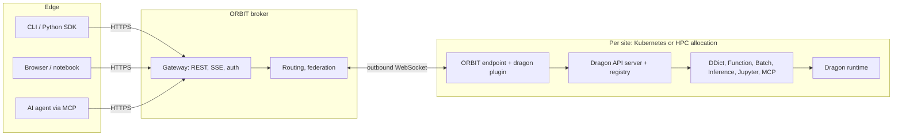
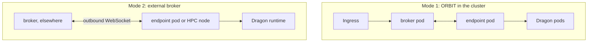

# Orbit-Dragon: scoping

Part of the SwarmSlicer project.  RADICAL (Rutgers) with HPE.
Date: 2026-10-30.  Audience: HPE (Andrew Shao, Maria Kalantzi).

## 1. Goal

ORBIT becomes the access layer for Dragon Core Workflow Services.  Users,
notebooks and AI agents reach Dragon services (DDict, Function, Batch,
Inference, Jupyter, MCP) through one ORBIT broker, with the same client
API whether the services run on Kubernetes or on an HPC allocation, and on
one site or several.

Dragon services stay the in-allocation layer and HPE owns them.  ORBIT
adds what sits between the user and the allocation: one authenticated
entry point, routing to many sites, connectivity through firewalls and
login nodes, and federation across sites.

## 2. What exists

**Dragon Core Workflow Services** (HPE): a service is a REST API on top
of a Dragon resource, with a URL and an entry in a shared registry.  An
API server inside the Dragon runtime creates, lists and deletes service
instances.  Clients use a CLI, a Python SDK, REST, or MCP tools.  Today
the services run on Kubernetes and in a local container; Slurm is next.

**ORBIT** (RADICAL): a broker hub and endpoints that dial it over one
outbound WebSocket.  Endpoints run on login nodes, compute nodes or in
containers and serve plugins (job submission, task execution, staging,
Globus, queue info).  The broker routes requests and events between
participants, exposes REST and SSE through its gateway, and federates
work across endpoints.  Endpoints reach the broker through SSH tunnels
where compute nodes have no outbound access (Perlmutter, Aurora, Odo).

## 3. Architecture



The endpoint's `dragon` plugin talks to the Dragon API server and maps its
registry into ORBIT's topology, so clients see each site's service
instances.  Service traffic flows through ORBIT; the user needs no direct
network path to the allocation.  Tokens issued by ORBIT are handed to the
Dragon services' auth hook.

## 4. Deployment



Kubernetes comes first; the cluster is to be decided.  Both modes are
supported: broker and endpoint as pods next to the Dragon pods, or only
the endpoint in the cluster, dialing a broker outside it.  Mode 2 is the
same pattern ORBIT uses on HPC, so HPC sites follow with the known tunnel
setups.

## 5. Proof of concept: DDict (November)

A client creates a DDict through ORBIT, reads and writes it, and a process
inside the Dragon runtime attaches to the same DDict.  Until we have
access to the services code, the plugin drives DDict directly through
public `dragonhpc` 0.15.0; the API server replaces those calls behind the
same routes.

Status, 2026-11-03: works on a laptop in both runtime modes (attach to a
running runtime, or start one); container image and compose setup for
both deployment modes written.  Client API, close to native DDict:

```python
dragon = rt.get_plugin('site', 'dragon')
dd = dragon.ddict.create(name='scratch', total_mem='512M')
dd['k'] = {'v': 1}
dd['k'], len(dd), dd.keys()
dd.descriptor        # DDict.attach(descriptor) inside the runtime
dd.destroy()
```

Next for the POC: run it on a Kubernetes cluster, then propose the next
meeting.

## 6. Work split

| RADICAL | HPE |
|---|---|
| `dragon` plugin: service lifecycle, registry → topology, proxying | Dragon services server, pip-installable |
| Client API and CLI mirroring Dragon's | Dragon launch on Kubernetes and Slurm/PBS |
| Gateway streaming channel | Auth hook accepting ORBIT tokens |
| Per-user identity and owner checks | Per-site Dragon fixes |
| Federation across sites, operator docs | MCP tools for Function and DDict |

## 7. Gaps on the ORBIT side

- **Streaming channel (4–6 weeks).**  Today a request travels as one frame
  (4 MiB cap) and the gateway does not upgrade to WebSockets.  Jupyter and
  streamed LLM output need byte streams through the broker with flow
  control.
- **Per-user security (3–4 weeks).**  Today one shared ingress token
  gates the broker.  Needed: per-user credentials, identity passed through
  to plugins and services, owner checks on every service instance.

Together these are about 7–10 of the ~12 weeks available.

## 8. Timeline

About 3 person-months on the RADICAL side, January to June 2027;
production readiness is best effort within that budget.

| When | Focus | Exit |
|---|---|---|
| Nov 2026 | DDict POC | DDict through ORBIT on Kubernetes |
| Jan | Code access, architecture note, plugin on the API server | Service lifecycle via ORBIT |
| Feb | Kubernetes, both modes | Function and Inference (no streaming) from a laptop |
| Mar | Streaming channel, per-user auth | Jupyter and LLM streaming; users isolated |
| Apr | First HPC site (Perlmutter), federation | Same services on Kubernetes and HPC, one broker |
| May | Second HPC site, first driving use case | Use case across two sites |
| Jun | Hardening, packaging, docs | Release, per-site recipes |

If time runs short we drop the second HPC site and the MCP integration
first.

## 9. Needed from HPE

1. Access to the Dragon services code or container image (gates January).
2. A Kubernetes cluster for development and the demo.
3. Driving use cases: which services must work end to end first.
4. A contact for the auth hook and the Slurm launch.
5. Which HPE machines to target, with accounts.
